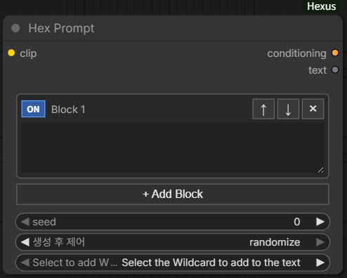
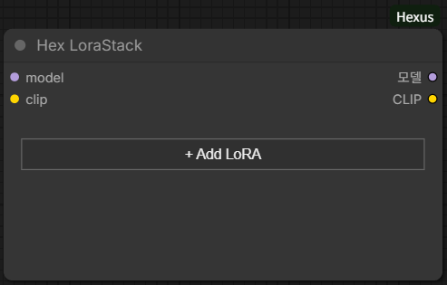
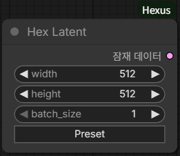
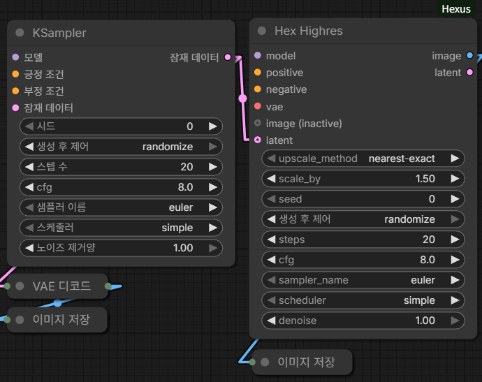
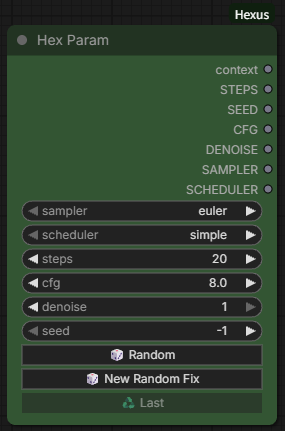
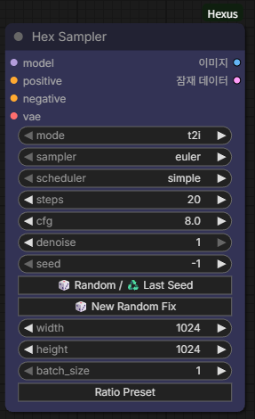
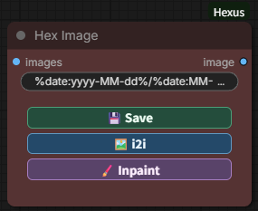

# ComfyUI-Hexus

ComfyUI 기본 노드와 자주 사용하는 커스텀 노드의 기능을 가져와, 표준 노드와 연결하기 쉬운 입출력으로 구성하는 커스텀 노드 패키지입니다.

ComfyUI-Hexus adapts features from core and commonly used custom nodes, with inputs and outputs designed to connect easily to standard ComfyUI nodes.

## 구성 노드 / Included Nodes

### Hex Prompt

<table><tr><td></td><td><ul>
<li>프롬프트 블록 추가·정렬·ON/OFF</li>
<li>와일드카드 지원</li>
</ul></td></tr></table>

### Hex LoraStack

<table><tr><td></td><td><ul>
<li>LoRA Stack</li>
<li>LoRA Preview</li>
</ul></td></tr></table>

### Hex Latent

<table><tr><td></td><td><ul>
<li>해상도 프리셋</li>
</ul></td></tr></table>

### Hex Highres

<table><tr><td></td><td><ul>
<li>KSampler 기반 Highres 워크플로 압축</li>
<li>KSampler(기본크기) → Highres → SaveImage</li>
</ul></td></tr></table>

### Hex Param

<table><tr><td></td><td><ul>
<li>Sampler·Scheduler·Steps·CFG·Denoise·Seed</li>
<li>context 묶음 및 각 파라미터 개별 출력</li>
</ul></td></tr></table>

### Hex Sampler

<table><tr><td></td><td><ul>
<li>t2i·i2i·Inpaint 모드 / 샘플링 파라미터 통합</li>
</ul></td></tr></table>

### Hex Image

<table><tr><td></td><td><ul>
<li>IMAGE 미리보기·저장</li>
<li>Step Preview (Hex Only) 토글로 생성 단계 미리보기 연산·표시 ON/OFF</li>
<li>i2i·Inpaint - Hex Sampler 연계</li>
</ul></td></tr></table>

## 의존성 / Dependencies

| 패키지 | 사용처 | 필요 여부 |
| --- | --- | --- |
| [ComfyUI](https://github.com/Comfy-Org/ComfyUI) | 노드 실행 및 기본 인코더·샘플러·업스케일러 | 필수 |
| [ComfyUI-Impact-Pack](https://github.com/ltdrdata/ComfyUI-Impact-Pack) | Hex Prompt의 와일드카드 처리와 목록 | 와일드 카드 사용시 필수 |
| [ComfyUI-Inspire-Pack](https://github.com/ltdrdata/ComfyUI-Inspire-Pack) | 함께 설치할 수 있는 노드팩; 현재 Hexus 코드에서 직접 호출하지 않음 | 선택 |

Hex LoraStack의 LoRA 정보·프리뷰 다운로드 기능은 Civitai API를 사용합니다. 이 기능을 사용할 때만 Civitai에 접속합니다.

## 라이선스 및 참고 프로젝트 / Licenses and References

이 저장소에는 현재 별도 `LICENSE` 파일이 없습니다. 아래는 사용하거나 기능·프리셋을 참고한 프로젝트의 라이선스입니다.

| 프로젝트 | 라이선스 | 관계 |
| --- | --- | --- |
| [ComfyUI](https://github.com/Comfy-Org/ComfyUI/blob/master/LICENSE) | GPL-3.0 | 실행 환경·기본 노드 호출 |
| [ComfyUI-Impact-Pack](https://github.com/ltdrdata/ComfyUI-Impact-Pack/blob/Main/LICENSE.txt) | GPL-3.0 | 와일드카드 기능 호출 |
| [ComfyUI-Inspire-Pack](https://github.com/ltdrdata/ComfyUI-Inspire-Pack/blob/main/LICENSE) | GPL-3.0 | 설치 권장; 현재 직접 호출하지 않음 |

각 라이선스의 원문과 적용 범위는 링크된 프로젝트에서 확인할 수 있습니다.

제가 직접 작성한 Hexus 코드와 문서는 자유롭게 사용·수정·재배포하셔도 됩니다. 제3자 프로젝트의 코드와 자료에는 각 프로젝트의 라이선스가 적용됩니다.
